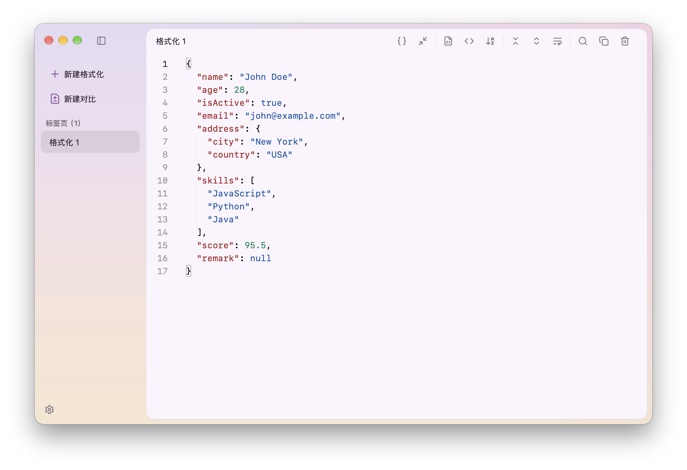
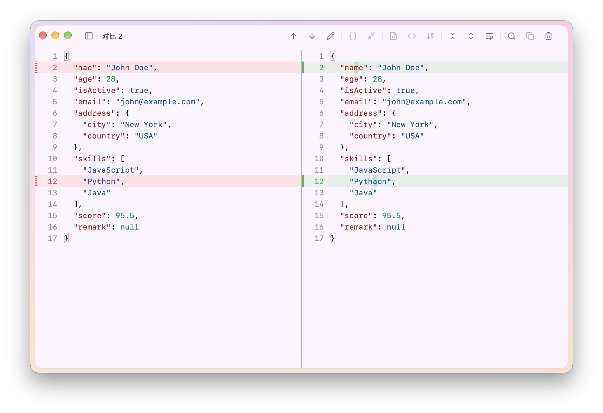

# MyJson

MyJson 是一款基于 Go 和 MyGo 构建的原生桌面 JSON 工具。

已支持的功能：格式化、压缩、转义、去转义、字段排序、差异对比

## 界面预览




## 下载安装

前往 [Releases](https://github.com/pupkkyuu/myjson/releases) 下载安装包。

## 从源码运行

需要 Go **1.27.3 或更高版本**。

```bash
git clone https://github.com/pupkkyuu/myjson.git
cd myjson
go mod download
go tool mygo dev
```

## 构建

```bash
# macOS Apple Silicon
go tool mygo build -platform darwin/arm64 -o build

# Windows amd64
go tool mygo build -platform windows/amd64 -o build
```

## 许可证

[MIT License](LICENSE)
